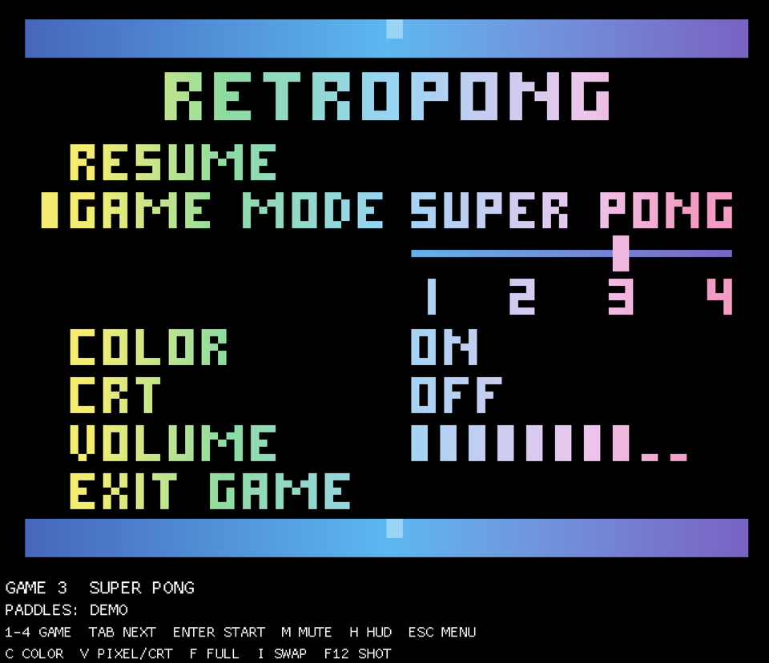
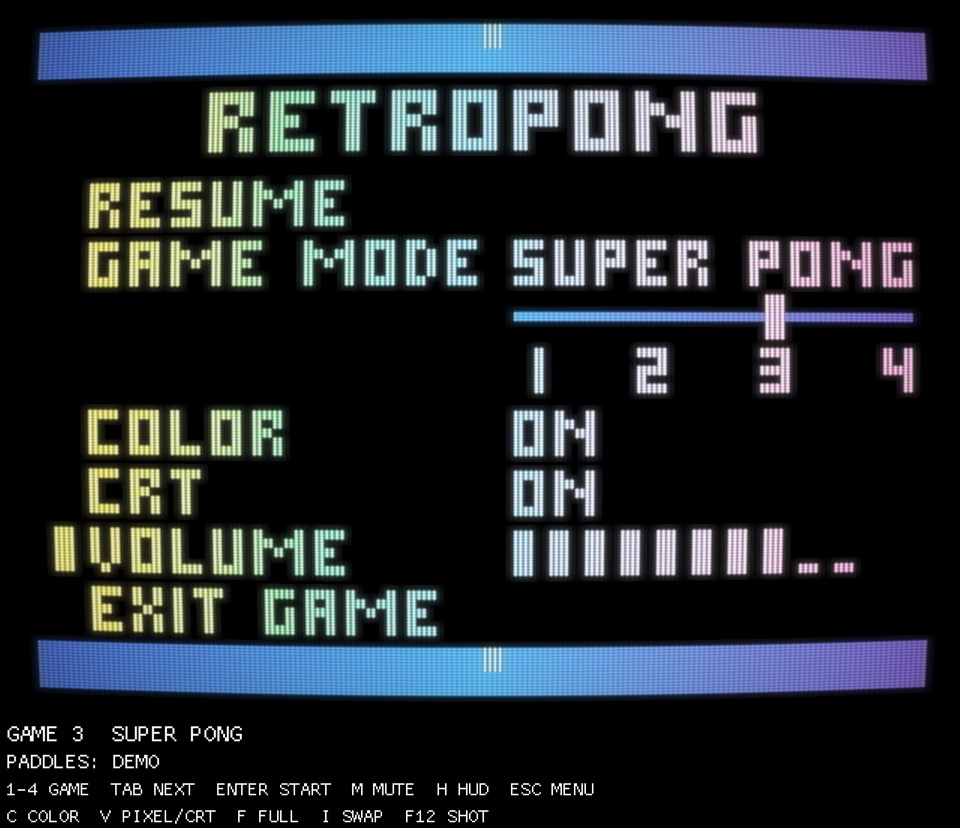
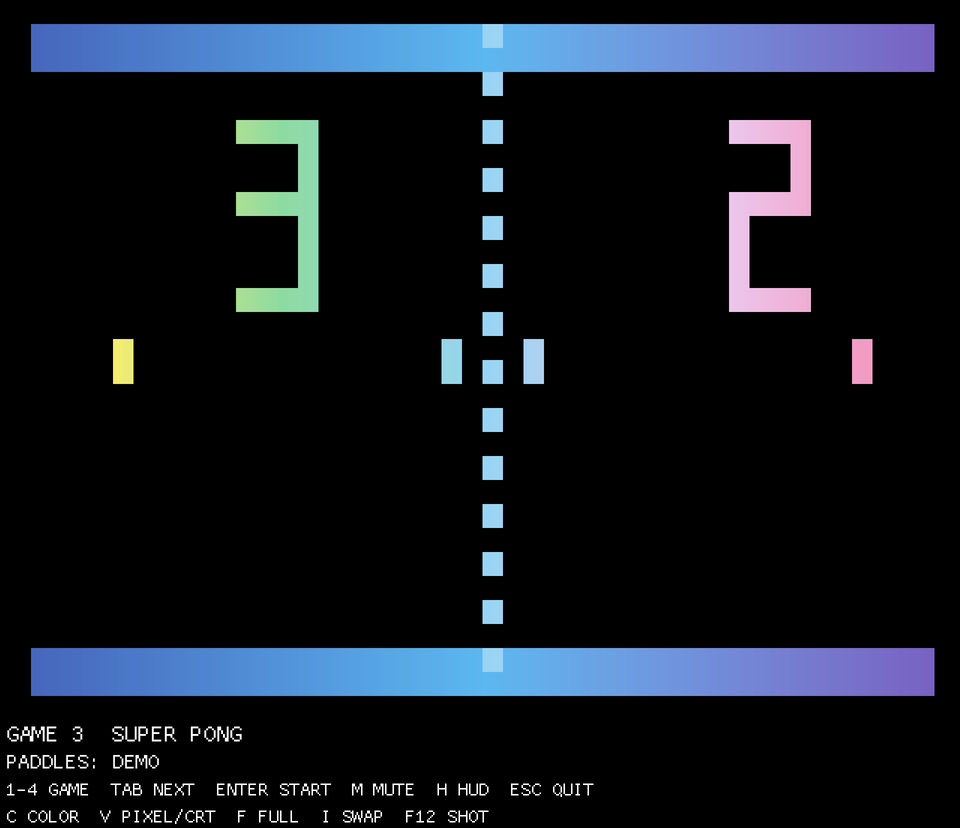
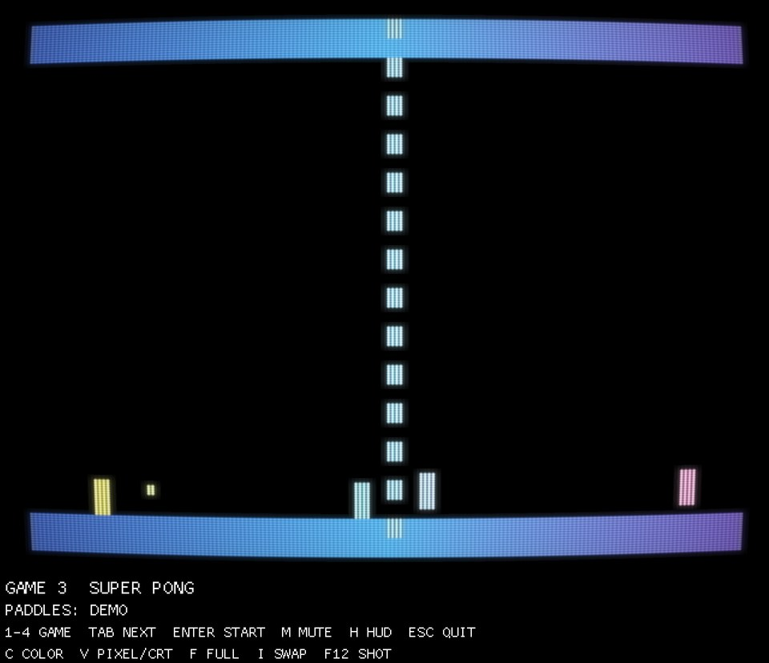

# `superpong` -- RetroPong, a clone of the Atari Super Pong C-140

The crate `superpong` builds the binary `retropong`: a macroquad frontend for
**RetroPong**, a clone of the four-game Atari **Super Pong** console (model
C-140, 1976): Catch, Solitaire, Super Pong and Pong. All game rules live in the
`superpong-core` crate (see `docs/SPEC-superpong.md`); this crate only
draws, synthesises and plays sound, and reads input devices. The core decides which
cells are lit; the frontend never re-implements a rule (it does not infer
paddle sides, and there is no randomness anywhere).

## Controls

RetroPong starts fullscreen with classic CRT video and no HUD. On first launch,
`PRESS ENTER TO START` and `PRESS ESC FOR MENU` appear in the game's raster.
They disappear on the first start and do not return between rounds.
Only one game instance can run on the machine; another launch exits with a
friendly message. Help and sound exports remain available while it runs.

| Control | Effect |
|---|---|
| RetroController paddles / gamepad axes | Left/right knob |
| `Enter` / keypad `Enter` | Start or restart; activate an open menu entry |
| `Esc` | Open/close the pause menu |
| Arrow keys | Navigate/change settings while the menu is open |

Use `--fullscreen false` for a window. Keyboard paddle controls and other
keyboard shortcuts are removed; knobs stay centred without a controller.

## The pause menu

`Esc` (or a gamepad's Start or South button) opens the pause menu, over a game
or over the light show. The original console had no pause, menu or volume control; this
is an addition. While the menu is open the console is frozen (the light show
stops too) and the sound is cut off. The menu is drawn as cells on the console's
own raster, in its cell kinds, so it takes the game's colours, the
black-and-white mode and the CRT shader. Spec section 13.6.

| Pixel | Classic CRT |
|---|---|
|  |  |

| Entry | Left / Right | Enter |
|---|---|---|
| `RESUME` | | closes the menu |
| `GAME MODE` | moves the Select Game switch (1-4) | steps it on, 4 wraps to 1 |
| `COLOR` | toggles colour / black-and-white | toggles |
| `CRT` | toggles classic video / pixel | toggles |
| `VOLUME` | volume -1 / +1 (0-10) | |
| `LEFT` | toggles left knob: `CCW UP` / `CW UP` | toggles |
| `RIGHT` | toggles right knob: `CCW UP` / `CW UP` | toggles |
| `EXIT GAME` | | quits the program |

Menu keys: `Up` / `Down` move the cursor, `Left` / `Right` change the entry,
`Enter` or keypad `Enter` activates, and `Esc` closes.
On a gamepad: the D-pad moves and changes, `Start` closes the menu, `South`
activates the entry under the cursor and `East` steps to the next entry,
wrapping at the bottom. A RetroController's left and right buttons are its
`South` and `East`.

Closing the menu over a running game starts a **3, 2, 1, GO countdown** (half a second
per step, each with a beep) before the console ticks again. The paddles follow
the knobs during it, `Esc` opens the menu again, and `Enter` do
nothing, so the match is never restarted by accident. Closing the menu over the
light show resumes at once.

The master volume is 0-10 (default 8, `--volume`); `--mute` starts muted; changing volume unmutes.

## The picture

The core rasterises the console's native display window: 187 chip clocks by
240 scan lines, at the console's own frame rate (59.94 Hz, or 60.19 Hz in
some phases). The frontend turns each cell into a colour from its kind
(background, border or lit) and its horizontal position. The background is
black; only the drawn elements carry colour, a left-to-right gradient through a
few anchor colours per kind, taken from the game's packaging art (yellow, green,
light blue, lilac and pink for everything lit; blue, sky blue and violet for the
borders) and blended in OKLab. Palette constants are documented in
[`colour_model.json`](../../docs/superpong-data/colour_model.json).

* The picture is always drawn in a 4:3 rectangle, the largest that fits above
  the window. Whole multiples of 240 lines are
  used when they cost little; otherwise nearest filtering is used.
* The COLOR menu entry / `--mono` switches to black-and-white (the luma term alone).
* The CRT menu entry / `--display <pixel|crt>` picks the display mode:
  * **pixel**: sharp square pixels, the exact colours of the spec and
    nothing else, as a modern monitor shows an image.
  * **crt** (default): classic video, as a 1970s colour TV showed it, in one shader pass
    (`src/crt.rs`, `src/shaders/crt.frag`, after Timothy Lottes' public-domain CRT
    shader): composite-style colour blur, the fine vertical stripe texture,
    scanlines whose beams widen with brightness, a little glow, an RGB phosphor
    mask and gentle curvature. Scanlines and mask fade out when lines are under
    3 device pixels tall, to avoid moire. If the shader cannot be compiled (or
    the backend is not OpenGL) the game stays in pixel mode and prints the reason to stderr.

| Pixel | Classic CRT (default) |
|---|---|
|  |  |

## Sound

There are no sound files. The four sounds (bounce, point, serve and the
light-show tick) are synthesised at startup from a model of the C-140's sound
output (a square wave taken from one bit of the line counter) and of its
speaker. See [the game specification](../../docs/SPEC-superpong.md#123-the-four-sounds-synthesised)
for the synthesis model.

* Every reflection plays the one bounce sound (about 493 Hz), as on the console.
* One channel: a new sound cuts off the one playing.
* `--mute` starts muted; volume 0 silences playback.
* `--export-sounds <dir>` writes the four sounds as WAV files (44.1 kHz,
  16-bit mono) into `<dir>` and exits, without opening a window.

## Paddle input

Every frame, the first of these that is available supplies both knobs:

1. **RetroController** over USB HID (`hidapi`), matched by
   `retrocontroller-protocol`'s VID/PID. Re-probed every 500 ms while not
   connected, so plugging it in mid-game works.
2. **Any other connected gamepad**, via `gilrs` (default axis-filtering
   disabled, since a paddle knob should read its full range, not a
   dead-zoned stick). Left knob = left stick X; right knob = left stick Y
   (gilrs already inverts Y, so "up" reads as knob `0.0`, matching the
   RetroController convention). A RetroController that gilrs also sees (over
   its evdev node) is skipped here only while hidapi already has it open
   over `hidraw` -- so if the udev rule below isn't installed, gilrs still
   drives it at reduced resolution.
3. Without a device, both knobs stay centred.

`--invert-left [true|false]` / `--invert-right [true|false]` adjust physical readings before reaching the
core. The menu’s `LEFT` and `RIGHT` entries independently choose which turn moves
each paddle up: `CW UP` (clockwise, default) or `CCW UP` (counterclockwise).
These corrections do not affect the internal `--demo` / `--knobs` QA inputs.

## Controller setup (Linux)

RetroController needs a udev rule to read the raw HID reports (there's no
default rule for `hidraw`, unlike the joystick/evdev node gilrs uses).
From the repo root:

```sh
sudo cargo run -p rcctl -- udev --install
# then replug the controller
```

See `tools/rcctl/README.md` for details. If hidapi still can't open the
device, gamepad input remains available as fallback.

## Build dependencies

| Platform | Needed |
|---|---|
| Linux (Debian/Ubuntu) | `pkg-config libudev-dev libasound2-dev libx11-dev libxi-dev libgl1-mesa-dev libxkbcommon-dev` at build time; `libx11-6 libxi6 libgl1 libxkbcommon0 libasound2 libudev1` at runtime (X11/GL are dlopen'd; `libasound` and `libudev` -- pulled in by hidapi's default `hidraw` backend and by gilrs-core -- are link-time dependencies) |
| macOS | Xcode command line tools only (system frameworks) |
| Windows | Not verified |

```sh
cargo build -p superpong --release
# binary at target/release/retropong
```

## CLI flags

| Flag | Effect |
|---|---|
| `--game <1-4>` | Initial Game Select position (default 3) |
| `--fullscreen [true|false]` | Fullscreen by default; false selects a window |
| `--mono` | Start in black-and-white instead of colour |
| `--display <pixel\|crt>` | Start in this display mode (default `crt`) |
| `--export-sounds <dir>` | Write the four synthesised sounds as WAV files into `<dir>`, then exit |
| `--mute` | Start muted |
| `--volume <0-10>` | Master volume at start (default 8) |
| `--invert-left [true\|false]`, `--invert-right [true\|false]` | Knob inversion (default true: CW UP); false selects CCW UP |
| `--wayland` | Prefer Wayland (falls back to X11) instead of X11-only |

| `--auto-start` | Headless: press Start on frame 2 |
| `--demo` | Headless: autopilot, see below |
| `--knobs <left> <right>` | Headless: fixed knob values (0.0-1.0) every frame, overriding all other input |

## Demo autopilot

`--demo` plays both sides so rallies happen on their own. Each reflection is
a decision (which segment of the paddle to hit with, which paddle in Super
Pong, how long to rally, which side lets the ball through), taken once per
console tick, so a demo plays identically at any display frame rate. It
steps the Solitaire wall and Catch walls out of the way, and presses Start 3 s
after each game over, so headless runs show varied rallies in all four games.

## Screenshot recipe (headless / CI)

Rendering is deterministic: the same flags and frame count give the same
picture. Frames are simulated at a fixed 1/60 s. On a desktop (macOS, or Linux
with a display) just run it; on a machine with no GPU or sound card wrap it in
a virtual X server (the ALSA "can't open PCM device" messages are harmless):

```sh
LIBGL_ALWAYS_SOFTWARE=1 xvfb-run -a -s "-screen 0 1024x768x24" \
  target/release/retropong --game 3 --auto-start --demo \
  --frames 3000 --screenshot shot.png
```

Internal QA capture recipes (hidden flags; no in-game screenshot command):

```sh
# the power-on light show (no Start pressed; knobs fixed)
target/release/retropong --game 3 --knobs 0.5 0.5 --frames 120 --screenshot light-show.png
# classic CRT mode, and black-and-white
target/release/retropong --game 3 --auto-start --demo --display crt \
  --frames 900 --screenshot super-pong-crt.jpg
target/release/retropong --game 4 --auto-start --demo --mono \
  --frames 600 --screenshot pong-mono.png
```

The menu pictures (`--menu-at <frame>` opens the menu on that frame, `--menu-item
<entry>` puts the cursor on an entry, and `--resume-at <frame>` closes it again
for the countdown; these three are hidden flags for screenshots):

```sh
target/release/retropong --game 3 --auto-start --demo --menu-at 600 \
  --menu-item game-mode --frames 610 --screenshot menu-pixel.png
target/release/retropong --game 3 --auto-start --demo --display crt --menu-at 600 \
  --menu-item volume --frames 610 --screenshot menu-crt.png
```
